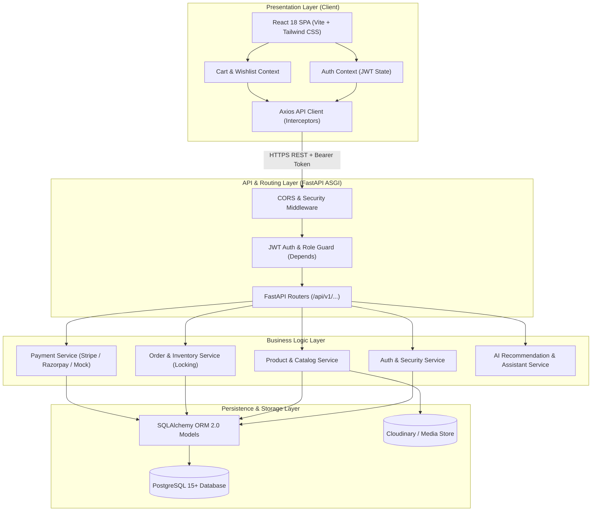
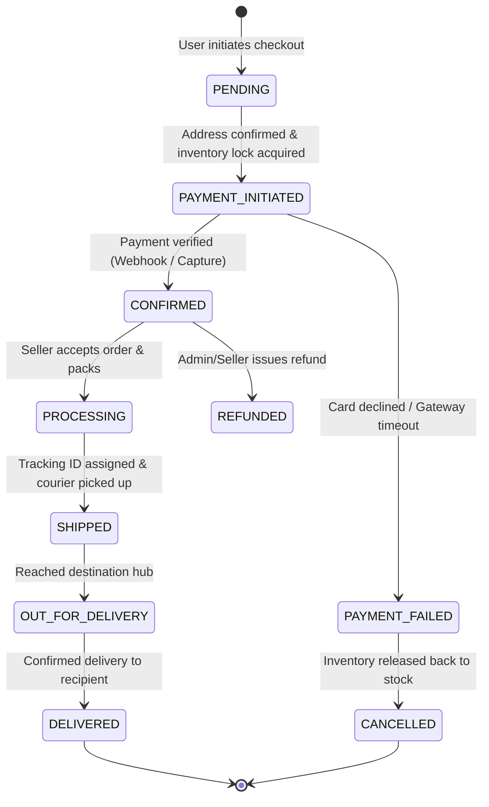

# ShopSphere — Architecture & System Design Document

---

## 1. System Architecture Overview

ShopSphere is organized into distinct logical layers to ensure separation of concerns, testability, horizontal scalability, and rapid maintainability.



---

## 2. Directory Structure Blueprint

```text
Ecommerce/
├── .env.example                  # Reference environment variables
├── .gitignore                    # Version control ignore rules
├── docker-compose.yml            # Multi-container orchestration (Frontend, Backend, DB)
├── README.md                     # Installation, run commands, and architecture docs
├── PRD.md                        # Product Requirements Document
├── TECH_STACK.md                 # Detailed technology specifications
├── GOALS.md                      # Milestone roadmap and acceptance criteria
├── RULES.md                      # Engineering rules and security standards
├── ARCHITECTURE.md               # System architecture and blueprint
├── DATABASE_SCHEMA.md            # Complete database schema and ER diagrams
│
├── backend/                      # Python FastAPI Application
│   ├── Dockerfile                # Backend container build configuration
│   ├── requirements.txt          # Python package dependencies
│   ├── pyproject.toml            # Code styling and pytest configuration
│   ├── alembic.ini               # Alembic database migration config
│   ├── migrations/               # Database migration scripts
│   │   ├── env.py
│   │   └── versions/
│   │
│   └── app/                      # Application Package Root
│       ├── __init__.py
│       ├── main.py               # FastAPI entry point & middleware setup
│       ├── core/                 # Core configs, security, and database engine
│       │   ├── __init__.py
│       │   ├── config.py         # Pydantic BaseSettings for env vars
│       │   ├── database.py       # SQLAlchemy engine & sessionmaker
│       │   ├── security.py       # Argon2 hashing & JWT utilities
│       │   └── dependencies.py   # Auth & role dependency injection
│       │
│       ├── models/               # SQLAlchemy ORM Database Models
│       │   ├── __init__.py
│       │   ├── user.py           # User, Role, Address
│       │   ├── seller.py         # SellerProfile
│       │   ├── product.py        # Category, Product, ProductImage, ProductVariant, Inventory
│       │   ├── cart.py           # Cart, CartItem, Wishlist
│       │   ├── order.py          # Order, OrderItem, Payment, Shipment
│       │   ├── review.py         # Review
│       │   ├── ai.py             # RecommendationEvent, UserInteraction
│       │   └── audit.py          # AuditLog
│       │
│       ├── schemas/              # Pydantic Request & Response Schemas
│       │   ├── __init__.py
│       │   ├── user.py
│       │   ├── product.py
│       │   ├── cart.py
│       │   ├── order.py
│       │   ├── payment.py
│       │   ├── review.py
│       │   ├── ai.py
│       │   └── dashboard.py
│       │
│       ├── services/             # Pure Business Logic Layer
│       │   ├── __init__.py
│       │   ├── auth_service.py
│       │   ├── product_service.py
│       │   ├── order_service.py  # Concurrency & row-locking checkout logic
│       │   ├── payment_service.py
│       │   ├── ai_service.py     # Recommendations & conversational shopping bot
│       │   └── audit_service.py
│       │
│       ├── routers/              # API Endpoints (/api/v1/...)
│       │   ├── __init__.py
│       │   ├── auth.py           # /api/v1/auth
│       │   ├── users.py          # /api/v1/users
│       │   ├── categories.py     # /api/v1/categories
│       │   ├── products.py       # /api/v1/products
│       │   ├── cart.py           # /api/v1/cart
│       │   ├── wishlist.py       # /api/v1/wishlist
│       │   ├── orders.py         # /api/v1/orders
│       │   ├── payments.py       # /api/v1/payments
│       │   ├── reviews.py        # /api/v1/reviews
│       │   ├── seller.py         # /api/v1/seller
│       │   ├── admin.py          # /api/v1/admin
│       │   └── ai.py             # /api/v1/ai
│       │
│       └── utils/                # Helper scripts & data seeds
│           ├── __init__.py
│           ├── seed_data.py      # Rich catalog & user seeder
│           └── pagination.py     # Reusable pagination helper
│
├── frontend/                     # React 18 + Vite Web Application
│   ├── Dockerfile                # Frontend multi-stage Nginx build
│   ├── package.json              # NPM dependencies & scripts
│   ├── vite.config.js            # Vite build configuration & proxy
│   ├── tailwind.config.js        # Tailwind custom theme & color tokens
│   ├── postcss.config.js         # PostCSS configuration
│   ├── index.html                # Single page app entry HTML
│   │
│   └── src/                      # Source code
│       ├── main.jsx              # React DOM render entry
│       ├── App.jsx               # Application root & Route configuration
│       ├── index.css             # Tailwind base and design utilities
│       │
│       ├── assets/               # Brand logos, fallback images, svg icons
│       │
│       ├── components/           # Reusable UI Components
│       │   ├── common/           # Button, Input, Modal, Badge, Skeleton, Toast
│       │   ├── layout/           # Navbar, CategoryBar, Footer, Sidebar
│       │   ├── catalog/          # ProductCard, ProductGrid, FilterSidebar, SortBar
│       │   ├── checkout/         # AddressSelector, OrderSummary, PaymentForm
│       │   ├── dashboard/        # StatCard, DataTable, StatusBadge, ChartCard
│       │   └── ai/               # ShoppingBotModal, ProductCompareModal, RecommendationRail
│       │
│       ├── context/              # Global React State Management
│       │   ├── AuthContext.jsx   # Current user, JWT storage, login/logout
│       │   ├── CartContext.jsx   # Cart items, counter, add/remove/update
│       │   ├── WishlistContext.jsx
│       │   └── ToastContext.jsx  # Notification dispatch system
│       │
│       ├── hooks/                # Custom React Hooks
│       │   ├── useDebounce.js    # Search query debounce hook
│       │   └── usePagination.js
│       │
│       ├── pages/                # Screen Views (Route Targets)
│       │   ├── Home.jsx          # Hero, Banners, Trending, Featured
│       │   ├── Catalog.jsx       # Search & Filter Product Grid
│       │   ├── ProductDetail.jsx # PDP with gallery, variants, reviews
│       │   ├── Cart.jsx          # Cart review & price breakdown
│       │   ├── Checkout.jsx      # Multi-step shipping & payment
│       │   ├── OrderConfirmation.jsx # Post-checkout receipt
│       │   ├── OrderTracking.jsx # Visual timeline tracking
│       │   ├── Profile.jsx       # User addresses & order history
│       │   ├── Login.jsx         # Customer login
│       │   ├── Register.jsx      # Account creation
│       │   ├── seller/           # Seller Portal Pages (Inventory, Orders)
│       │   │   ├── SellerDashboard.jsx
│       │   │   ├── SellerProducts.jsx
│       │   │   └── SellerOrders.jsx
│       │   └── admin/            # Admin Control Center Pages
│       │       ├── AdminDashboard.jsx
│       │       ├── AdminUsers.jsx
│       │       ├── AdminProducts.jsx
│       │       └── AdminAuditLogs.jsx
│       │
│       └── services/             # HTTP API client services
│           ├── api.js            # Axios base instance & JWT interceptor
│           ├── authService.js
│           ├── productService.js
│           ├── cartService.js
│           ├── orderService.js
│           ├── paymentService.js
│           ├── sellerService.js
│           ├── adminService.js
│           └── aiService.js
│
└── tests/                        # Automated Test Suites
    ├── conftest.py               # Test database fixtures and client overrides
    ├── test_auth.py              # User registration and login tests
    ├── test_catalog.py           # Product listing, search, and filter tests
    ├── test_cart.py              # Cart item calculation tests
    ├── test_orders.py            # Order placement and inventory lock tests
    └── test_payments.py          # Payment signature and webhook tests
```

---

## 3. Order & Concurrency State Machine

To prevent inventory overselling and ensure auditability, checkout transitions through strict states:



---

## 4. API Endpoint Blueprint

| Domain | Method | Endpoint | Access Level | Description |
| :--- | :--- | :--- | :--- | :--- |
| **System** | `GET` | `/api/v1/health` | Public | System & DB connection health check |
| **Auth** | `POST` | `/api/v1/auth/register` | Public | Register new customer or seller |
| **Auth** | `POST` | `/api/v1/auth/login` | Public | Authenticate and issue JWT access token |
| **Auth** | `GET` | `/api/v1/auth/me` | Authenticated | Fetch current user profile & role |
| **Products** | `GET` | `/api/v1/products` | Public | Search, filter, paginate catalog items |
| **Products** | `GET` | `/api/v1/products/{slug_or_id}` | Public | Detailed product data with variants |
| **Cart** | `GET` | `/api/v1/cart` | Authenticated/Guest | Fetch user shopping cart items |
| **Cart** | `POST` | `/api/v1/cart/items` | Authenticated/Guest | Add item to cart with stock validation |
| **Cart** | `PUT` | `/api/v1/cart/items/{id}` | Authenticated/Guest | Update item quantity |
| **Cart** | `DELETE`| `/api/v1/cart/items/{id}` | Authenticated/Guest | Remove item from cart |
| **Orders** | `POST` | `/api/v1/orders` | Customer | Create order with inventory row locks |
| **Orders** | `GET` | `/api/v1/orders` | Customer | List authenticated user's order history |
| **Orders** | `GET` | `/api/v1/orders/{id}` | Customer/Seller/Admin | Order details and timeline tracking |
| **Payments**| `POST` | `/api/v1/payments/create-intent` | Customer | Initialize Stripe / Razorpay / Mock payment |
| **Payments**| `POST` | `/api/v1/payments/verify` | Customer | Verify payment signature and confirm order |
| **Seller** | `GET` | `/api/v1/seller/products` | Seller | Manage seller-specific listings |
| **Seller** | `POST` | `/api/v1/seller/products` | Seller | Create a new product listing |
| **Seller** | `GET` | `/api/v1/seller/orders` | Seller | View fulfillment orders for seller items |
| **Admin** | `GET` | `/api/v1/admin/analytics` | Admin | Aggregate GMV, revenue, and user metrics |
| **Admin** | `GET` | `/api/v1/admin/users` | Admin | User and seller account management |
| **Admin** | `GET` | `/api/v1/admin/audit-logs` | Admin | View immutable system audit trails |
| **AI** | `GET` | `/api/v1/ai/recommendations`| Public | Fetch contextual or personalized items |
| **AI** | `POST` | `/api/v1/ai/assistant/chat` | Public | Conversational grounded catalog Q&A |
| **AI** | `GET` | `/api/v1/ai/search/semantic` | Public | Vector/meaning-based product search |
