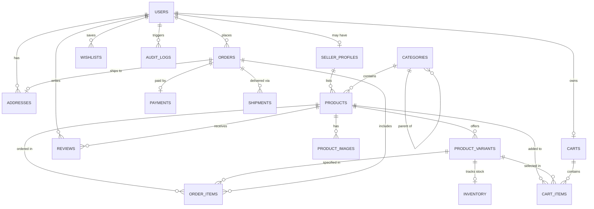

# ShopSphere — Database Schema Specification

---

## 1. Entity-Relationship (ER) Overview

ShopSphere uses a fully normalized relational schema designed for high-concurrency e-commerce operations in **PostgreSQL 15+**. Monetary amounts strictly utilize `NUMERIC(10, 2)` to eliminate floating-point rounding errors.

---

## 2. Table Specifications

### 2.1 Identity & Governance

#### `roles`
System-wide access roles.
| Column | Type | Constraints | Description |
| :--- | :--- | :--- | :--- |
| `id` | `INTEGER` | `PRIMARY KEY, AUTO_INCREMENT` | Role ID |
| `name` | `VARCHAR(32)` | `UNIQUE, NOT NULL` | Role name (`CUSTOMER`, `SELLER`, `ADMIN`) |
| `description`| `VARCHAR(255)` | `NULLABLE` | Human-readable role description |

#### `users`
Registered user accounts.
| Column | Type | Constraints | Description |
| :--- | :--- | :--- | :--- |
| `id` | `UUID` | `PRIMARY KEY, DEFAULT gen_random_uuid()` | Unique user identifier |
| `email` | `VARCHAR(255)` | `UNIQUE, NOT NULL, INDEX` | User login email |
| `hashed_password` | `VARCHAR(255)` | `NOT NULL` | Argon2/bcrypt password hash |
| `first_name` | `VARCHAR(64)` | `NOT NULL` | First name |
| `last_name` | `VARCHAR(64)` | `NOT NULL` | Last name |
| `phone_number` | `VARCHAR(32)` | `NULLABLE` | Contact phone number |
| `role_id` | `INTEGER` | `NOT NULL, REFERENCES roles(id)` | Foreign key to roles |
| `is_active` | `BOOLEAN` | `DEFAULT TRUE, NOT NULL` | Account active status |
| `is_verified` | `BOOLEAN` | `DEFAULT FALSE, NOT NULL` | Email verification flag |
| `created_at` | `TIMESTAMPTZ` | `DEFAULT NOW(), NOT NULL` | Account creation timestamp |
| `updated_at` | `TIMESTAMPTZ` | `DEFAULT NOW(), NOT NULL` | Last modification timestamp |

#### `seller_profiles`
Extended vendor profile for seller accounts.
| Column | Type | Constraints | Description |
| :--- | :--- | :--- | :--- |
| `id` | `UUID` | `PRIMARY KEY, DEFAULT gen_random_uuid()` | Seller Profile ID |
| `user_id` | `UUID` | `UNIQUE, NOT NULL, REFERENCES users(id) ON DELETE CASCADE` | Associated user |
| `store_name` | `VARCHAR(128)` | `UNIQUE, NOT NULL` | Public seller store name |
| `store_slug` | `VARCHAR(128)` | `UNIQUE, NOT NULL, INDEX` | URL-friendly store slug |
| `description`| `TEXT` | `NULLABLE` | Store bio and policies |
| `tax_id` | `VARCHAR(64)` | `NULLABLE` | Business Tax ID / GSTIN |
| `is_approved`| `BOOLEAN` | `DEFAULT FALSE, NOT NULL` | Admin approval status |
| `created_at` | `TIMESTAMPTZ` | `DEFAULT NOW(), NOT NULL` | Registration timestamp |

#### `addresses`
Customer shipping and billing addresses.
| Column | Type | Constraints | Description |
| :--- | :--- | :--- | :--- |
| `id` | `UUID` | `PRIMARY KEY, DEFAULT gen_random_uuid()` | Address ID |
| `user_id` | `UUID` | `NOT NULL, REFERENCES users(id) ON DELETE CASCADE` | Owner user ID |
| `full_name` | `VARCHAR(128)` | `NOT NULL` | Recipient contact name |
| `phone_number`| `VARCHAR(32)`| `NOT NULL` | Recipient phone number |
| `address_line1`| `VARCHAR(255)`| `NOT NULL` | Street address, building number |
| `address_line2`| `VARCHAR(255)`| `NULLABLE` | Apartment, suite, unit |
| `city` | `VARCHAR(64)` | `NOT NULL` | City or municipality |
| `state` | `VARCHAR(64)` | `NOT NULL` | State or province |
| `postal_code`| `VARCHAR(20)` | `NOT NULL` | Postal / PIN code |
| `country` | `VARCHAR(64)` | `DEFAULT 'India', NOT NULL` | Country |
| `is_default` | `BOOLEAN` | `DEFAULT FALSE, NOT NULL` | Default shipping address |
| `created_at` | `TIMESTAMPTZ` | `DEFAULT NOW(), NOT NULL` | Creation timestamp |

---

### 2.2 Catalog & Inventory

#### `categories`
Hierarchical category tree.
| Column | Type | Constraints | Description |
| :--- | :--- | :--- | :--- |
| `id` | `INTEGER` | `PRIMARY KEY, AUTO_INCREMENT` | Category ID |
| `name` | `VARCHAR(64)` | `NOT NULL` | Category title |
| `slug` | `VARCHAR(64)` | `UNIQUE, NOT NULL, INDEX` | URL slug |
| `parent_id` | `INTEGER` | `NULLABLE, REFERENCES categories(id) ON DELETE SET NULL` | Parent category |
| `image_url` | `VARCHAR(512)`| `NULLABLE` | Representative icon/banner URL |
| `is_active` | `BOOLEAN` | `DEFAULT TRUE, NOT NULL` | Active status |

#### `products`
Core product catalog table.
| Column | Type | Constraints | Description |
| :--- | :--- | :--- | :--- |
| `id` | `UUID` | `PRIMARY KEY, DEFAULT gen_random_uuid()` | Product ID |
| `seller_id` | `UUID` | `NOT NULL, REFERENCES seller_profiles(id) ON DELETE CASCADE` | Owner seller |
| `category_id`| `INTEGER` | `NOT NULL, REFERENCES categories(id)` | Primary category |
| `title` | `VARCHAR(255)`| `NOT NULL, INDEX` | Product title |
| `slug` | `VARCHAR(280)`| `UNIQUE, NOT NULL, INDEX` | SEO-friendly unique slug |
| `brand` | `VARCHAR(64)` | `NOT NULL, INDEX` | Brand / Manufacturer |
| `description`| `TEXT` | `NOT NULL` | Markdown / Rich description |
| `base_price` | `NUMERIC(10, 2)`| `NOT NULL` | Standard MSRP price |
| `discount_price`| `NUMERIC(10, 2)`| `NULLABLE` | Active promotional price |
| `rating_avg` | `NUMERIC(3, 2)` | `DEFAULT 0.00, NOT NULL` | Cached average rating (0-5) |
| `rating_count`| `INTEGER` | `DEFAULT 0, NOT NULL` | Total number of reviews |
| `is_active` | `BOOLEAN` | `DEFAULT TRUE, NOT NULL, INDEX` | Published status |
| `is_featured`| `BOOLEAN` | `DEFAULT FALSE, NOT NULL` | Featured on homepage flag |
| `created_at` | `TIMESTAMPTZ` | `DEFAULT NOW(), NOT NULL` | Created at |
| `updated_at` | `TIMESTAMPTZ` | `DEFAULT NOW(), NOT NULL` | Updated at |

#### `product_images`
Product photo gallery.
| Column | Type | Constraints | Description |
| :--- | :--- | :--- | :--- |
| `id` | `UUID` | `PRIMARY KEY, DEFAULT gen_random_uuid()` | Image ID |
| `product_id` | `UUID` | `NOT NULL, REFERENCES products(id) ON DELETE CASCADE` | Parent product |
| `image_url` | `VARCHAR(512)`| `NOT NULL` | Cloudinary / local static URL |
| `alt_text` | `VARCHAR(255)`| `NULLABLE` | Accessible alt description |
| `sort_order` | `INTEGER` | `DEFAULT 0, NOT NULL` | Display order (0 = primary) |

#### `product_variants`
SKU-level variant variations (e.g. Color, Size).
| Column | Type | Constraints | Description |
| :--- | :--- | :--- | :--- |
| `id` | `UUID` | `PRIMARY KEY, DEFAULT gen_random_uuid()` | Variant ID |
| `product_id` | `UUID` | `NOT NULL, REFERENCES products(id) ON DELETE CASCADE` | Parent product |
| `sku` | `VARCHAR(64)` | `UNIQUE, NOT NULL, INDEX` | Unique SKU identifier |
| `title` | `VARCHAR(128)`| `NOT NULL` | Variant title (e.g. "Midnight Blue / 256GB") |
| `price_override`| `NUMERIC(10, 2)`| `NULLABLE` | Variant-specific price override |
| `attributes` | `JSONB` | `DEFAULT '{}'::jsonb, NOT NULL` | Key-value pairs (`{"color": "Blue", "size": "M"}`) |

#### `inventory`
Stock tracking with reservation support.
| Column | Type | Constraints | Description |
| :--- | :--- | :--- | :--- |
| `id` | `UUID` | `PRIMARY KEY, DEFAULT gen_random_uuid()` | Inventory ID |
| `variant_id` | `UUID` | `UNIQUE, NOT NULL, REFERENCES product_variants(id) ON DELETE CASCADE` | Associated variant |
| `quantity` | `INTEGER` | `NOT NULL, CHECK (quantity >= 0)` | Available physical stock |
| `reserved_qty`| `INTEGER` | `DEFAULT 0, NOT NULL, CHECK (reserved_qty >= 0)` | Stock held in checkout locks |
| `low_stock_threshold`| `INTEGER`| `DEFAULT 5, NOT NULL` | Low stock warning threshold |
| `updated_at` | `TIMESTAMPTZ` | `DEFAULT NOW(), NOT NULL` | Last stock adjustment |

---

### 2.3 Shopping Cart & Wishlist

#### `carts`
User or guest shopping sessions.
| Column | Type | Constraints | Description |
| :--- | :--- | :--- | :--- |
| `id` | `UUID` | `PRIMARY KEY, DEFAULT gen_random_uuid()` | Cart ID |
| `user_id` | `UUID` | `UNIQUE, NULLABLE, REFERENCES users(id) ON DELETE CASCADE` | Authenticated owner |
| `session_token`| `VARCHAR(64)`| `NULLABLE, INDEX` | Guest session tracking token |
| `created_at` | `TIMESTAMPTZ` | `DEFAULT NOW(), NOT NULL` | Creation timestamp |
| `updated_at` | `TIMESTAMPTZ` | `DEFAULT NOW(), NOT NULL` | Last activity timestamp |

#### `cart_items`
Individual line items in a cart.
| Column | Type | Constraints | Description |
| :--- | :--- | :--- | :--- |
| `id` | `UUID` | `PRIMARY KEY, DEFAULT gen_random_uuid()` | Cart Item ID |
| `cart_id` | `UUID` | `NOT NULL, REFERENCES carts(id) ON DELETE CASCADE` | Parent cart |
| `product_id` | `UUID` | `NOT NULL, REFERENCES products(id)` | Product |
| `variant_id` | `UUID` | `NOT NULL, REFERENCES product_variants(id)` | Selected variant |
| `quantity` | `INTEGER` | `DEFAULT 1, NOT NULL, CHECK (quantity > 0)` | Item quantity |
| `added_at` | `TIMESTAMPTZ` | `DEFAULT NOW(), NOT NULL` | Timestamp added |

#### `wishlists`
Customer saved items.
| Column | Type | Constraints | Description |
| :--- | :--- | :--- | :--- |
| `id` | `UUID` | `PRIMARY KEY, DEFAULT gen_random_uuid()` | Wishlist Item ID |
| `user_id` | `UUID` | `NOT NULL, REFERENCES users(id) ON DELETE CASCADE` | User owner |
| `product_id` | `UUID` | `NOT NULL, REFERENCES products(id) ON DELETE CASCADE` | Saved product |
| `created_at` | `TIMESTAMPTZ` | `DEFAULT NOW(), NOT NULL` | Saved timestamp |

---

### 2.4 Orders, Payments & Fulfillment

#### `orders`
Master order records.
| Column | Type | Constraints | Description |
| :--- | :--- | :--- | :--- |
| `id` | `UUID` | `PRIMARY KEY, DEFAULT gen_random_uuid()` | Order ID |
| `order_number` | `VARCHAR(32)` | `UNIQUE, NOT NULL, INDEX` | Human-friendly reference (`SS-2026-XXXX`) |
| `user_id` | `UUID` | `NOT NULL, REFERENCES users(id)` | Purchasing customer |
| `shipping_address_id` | `UUID` | `NOT NULL, REFERENCES addresses(id)` | Shipping destination |
| `subtotal` | `NUMERIC(10, 2)`| `NOT NULL` | Sum of item amounts |
| `discount_amount`| `NUMERIC(10, 2)`| `DEFAULT 0.00, NOT NULL` | Total coupon/promo savings |
| `shipping_fee` | `NUMERIC(10, 2)`| `DEFAULT 0.00, NOT NULL` | Applied shipping cost |
| `tax_amount` | `NUMERIC(10, 2)`| `DEFAULT 0.00, NOT NULL` | Calculated taxes |
| `total_amount` | `NUMERIC(10, 2)`| `NOT NULL` | Final payable total |
| `status` | `VARCHAR(32)` | `DEFAULT 'PENDING', NOT NULL, INDEX` | Status (`PENDING`, `CONFIRMED`, `PROCESSING`, `SHIPPED`, `DELIVERED`, `CANCELLED`, `REFUNDED`) |
| `payment_status` | `VARCHAR(32)` | `DEFAULT 'UNPAID', NOT NULL` | (`UNPAID`, `PAID`, `FAILED`, `REFUNDED`) |
| `created_at` | `TIMESTAMPTZ` | `DEFAULT NOW(), NOT NULL` | Order placement timestamp |
| `updated_at` | `TIMESTAMPTZ` | `DEFAULT NOW(), NOT NULL` | Last status update |

#### `order_items`
Snapshot of line items at the time of purchase.
| Column | Type | Constraints | Description |
| :--- | :--- | :--- | :--- |
| `id` | `UUID` | `PRIMARY KEY, DEFAULT gen_random_uuid()` | Order Item ID |
| `order_id` | `UUID` | `NOT NULL, REFERENCES orders(id) ON DELETE CASCADE` | Parent order |
| `product_id` | `UUID` | `NOT NULL, REFERENCES products(id)` | Product snapshot |
| `variant_id` | `UUID` | `NOT NULL, REFERENCES product_variants(id)` | Variant snapshot |
| `seller_id` | `UUID` | `NOT NULL, REFERENCES seller_profiles(id)` | Seller fulfilling this item |
| `product_title`| `VARCHAR(255)`| `NOT NULL` | Frozen title at checkout |
| `unit_price` | `NUMERIC(10, 2)`| `NOT NULL` | Frozen unit price at checkout |
| `quantity` | `INTEGER` | `NOT NULL, CHECK (quantity > 0)` | Quantity purchased |
| `total_price` | `NUMERIC(10, 2)`| `NOT NULL` | `unit_price * quantity` |

#### `payments`
Payment gateway transactions and webhooks.
| Column | Type | Constraints | Description |
| :--- | :--- | :--- | :--- |
| `id` | `UUID` | `PRIMARY KEY, DEFAULT gen_random_uuid()` | Payment record ID |
| `order_id` | `UUID` | `UNIQUE, NOT NULL, REFERENCES orders(id)` | Associated order |
| `provider` | `VARCHAR(32)` | `NOT NULL` | Gateway (`STRIPE`, `RAZORPAY`, `MOCK`) |
| `transaction_id`| `VARCHAR(128)`| `UNIQUE, NOT NULL, INDEX` | Gateway transaction ID |
| `amount` | `NUMERIC(10, 2)`| `NOT NULL` | Payment amount captured |
| `currency` | `VARCHAR(3)` | `DEFAULT 'INR', NOT NULL` | 3-letter currency code |
| `status` | `VARCHAR(32)` | `NOT NULL` | (`SUCCESS`, `PENDING`, `FAILED`) |
| `raw_payload` | `JSONB` | `NULLABLE` | Gateway webhook payload log |
| `created_at` | `TIMESTAMPTZ` | `DEFAULT NOW(), NOT NULL` | Payment timestamp |

#### `shipments`
Delivery and logistics tracking.
| Column | Type | Constraints | Description |
| :--- | :--- | :--- | :--- |
| `id` | `UUID` | `PRIMARY KEY, DEFAULT gen_random_uuid()` | Shipment ID |
| `order_id` | `UUID` | `NOT NULL, REFERENCES orders(id)` | Order |
| `carrier` | `VARCHAR(64)` | `NOT NULL` | Courier carrier (e.g., BlueDart, FedEx) |
| `tracking_number`| `VARCHAR(128)`| `NULLABLE, INDEX` | Courier tracking code |
| `status` | `VARCHAR(32)` | `DEFAULT 'LABEL_CREATED', NOT NULL` | (`LABEL_CREATED`, `PICKED_UP`, `IN_TRANSIT`, `OUT_FOR_DELIVERY`, `DELIVERED`) |
| `estimated_delivery`| `TIMESTAMPTZ`| `NULLABLE` | Estimated delivery time |
| `updated_at` | `TIMESTAMPTZ` | `DEFAULT NOW(), NOT NULL` | Status update timestamp |

---

### 2.5 Reviews, Coupons, AI & Audit

#### `reviews`
Customer product reviews with purchase verification.
| Column | Type | Constraints | Description |
| :--- | :--- | :--- | :--- |
| `id` | `UUID` | `PRIMARY KEY, DEFAULT gen_random_uuid()` | Review ID |
| `user_id` | `UUID` | `NOT NULL, REFERENCES users(id)` | Author |
| `product_id` | `UUID` | `NOT NULL, REFERENCES products(id) ON DELETE CASCADE` | Reviewed product |
| `order_id` | `UUID` | `NULLABLE, REFERENCES orders(id)` | Verified purchase link |
| `rating` | `INTEGER` | `NOT NULL, CHECK (rating >= 1 AND rating <= 5)` | Star rating (1-5) |
| `title` | `VARCHAR(128)`| `NULLABLE` | Review headline |
| `comment` | `TEXT` | `NOT NULL` | Detailed review |
| `is_verified` | `BOOLEAN` | `DEFAULT FALSE, NOT NULL` | Verified buyer flag |
| `is_approved` | `BOOLEAN` | `DEFAULT TRUE, NOT NULL` | Admin moderation flag |
| `created_at` | `TIMESTAMPTZ` | `DEFAULT NOW(), NOT NULL` | Review submission timestamp |

#### `coupons`
Discount codes.
| Column | Type | Constraints | Description |
| :--- | :--- | :--- | :--- |
| `id` | `INTEGER` | `PRIMARY KEY, AUTO_INCREMENT` | Coupon ID |
| `code` | `VARCHAR(32)` | `UNIQUE, NOT NULL, INDEX` | Promo code string (e.g. `WELCOME10`) |
| `discount_type`| `VARCHAR(16)` | `NOT NULL` | `PERCENTAGE` or `FIXED` |
| `discount_val` | `NUMERIC(10, 2)`| `NOT NULL` | Discount rate or fixed amount |
| `min_spend` | `NUMERIC(10, 2)`| `DEFAULT 0.00, NOT NULL` | Minimum subtotal required |
| `max_discount` | `NUMERIC(10, 2)`| `NULLABLE` | Max cap for percentage discounts |
| `valid_from` | `TIMESTAMPTZ` | `NOT NULL` | Start timestamp |
| `valid_until`| `TIMESTAMPTZ` | `NOT NULL` | Expiration timestamp |
| `is_active` | `BOOLEAN` | `DEFAULT TRUE, NOT NULL` | Active toggle |

#### `user_events`
Browsing signals for the AI recommendation engine and recently viewed rail.
| Column | Type | Constraints | Description |
| :--- | :--- | :--- | :--- |
| `id` | `BIGSERIAL` | `PRIMARY KEY` | Event ID |
| `user_id` | `UUID` | `NULLABLE, REFERENCES users(id) ON DELETE CASCADE` | User (if authenticated) |
| `session_token`| `VARCHAR(64)`| `NULLABLE, INDEX` | Guest session token |
| `product_id` | `UUID` | `NOT NULL, REFERENCES products(id) ON DELETE CASCADE` | Viewed / interacted product |
| `event_type` | `VARCHAR(32)` | `NOT NULL` | (`VIEW`, `ADD_TO_CART`, `WISHLIST`, `PURCHASE`) |
| `created_at` | `TIMESTAMPTZ` | `DEFAULT NOW(), NOT NULL, INDEX` | Event timestamp |

#### `audit_logs`
Immutable administrative audit trails.
| Column | Type | Constraints | Description |
| :--- | :--- | :--- | :--- |
| `id` | `BIGSERIAL` | `PRIMARY KEY` | Audit record ID |
| `user_id` | `UUID` | `NULLABLE, REFERENCES users(id)` | Actor who performed the action |
| `action` | `VARCHAR(64)` | `NOT NULL, INDEX` | (`PRICE_CHANGE`, `ROLE_UPDATE`, `REFUND_ISSUED`, `PRODUCT_DEACTIVATED`) |
| `target_entity`| `VARCHAR(64)`| `NOT NULL` | (`Product`, `User`, `Order`) |
| `target_id` | `VARCHAR(64)` | `NOT NULL` | ID of the affected entity |
| `old_value` | `JSONB` | `NULLABLE` | State before modification |
| `new_value` | `JSONB` | `NULLABLE` | State after modification |
| `ip_address` | `VARCHAR(45)` | `NULLABLE` | Client IP address |
| `created_at` | `TIMESTAMPTZ` | `DEFAULT NOW(), NOT NULL, INDEX` | Action timestamp |
